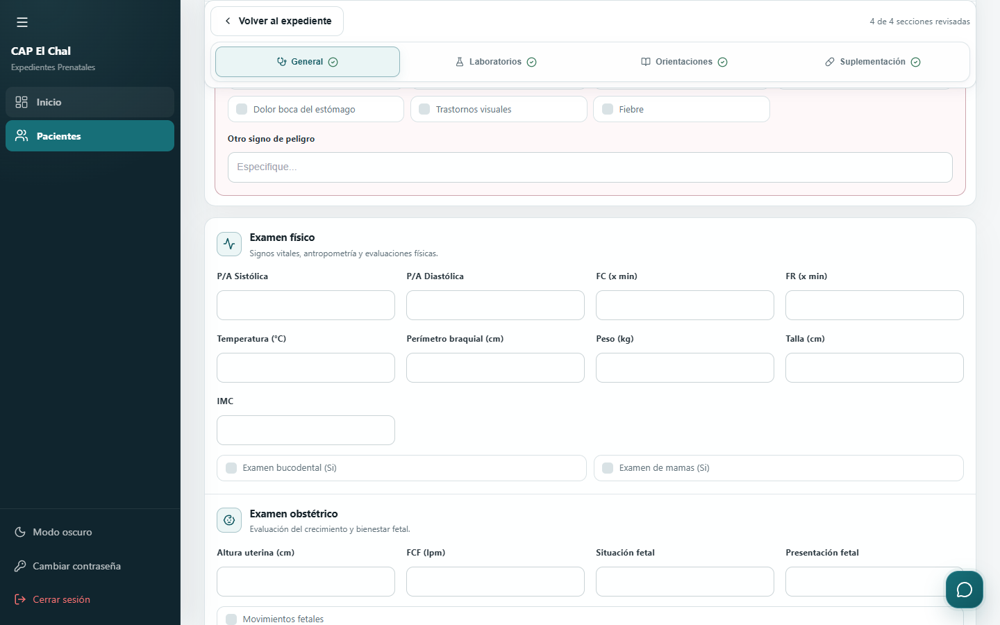
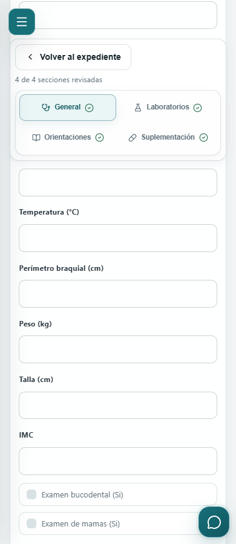

# CPREN-125 — Hotfix UX de controles prenatales

## Alcance y revisión

Hotfix independiente de `origin/main` verificado en
`e07cef00f0a20931bf92e7f8f00eed2ae25d23e0`. Rama:
`hotfix/cpren-125-ux-controles-prenatales`.
El checkout original de CPREN-119 queda en
`6f15fef6dbc61a2355ef5f0f3f0c69e9c44eb821`.

1. Orden General, Laboratorios, Orientaciones y Suplementación, con los mismos
   IDs, rutas y navegación por flechas/Home/End.
2. Retiro de captura de `impresion_clinica` y `tratamiento` del control general.
   Se omiten de POST/PUT; el PUT parcial existente preserva sus históricos.
   El historial conserva su consulta. La suplementación conserva sus propios
   hallazgos/indicaciones. Cita siguiente sigue siendo el último campo de General;
   las citas estructuradas siguen en lectura y se omiten del PUT.
3. Una barra sticky específica del prenatal agrupa regreso al expediente y
   pestañas. Se coloca antes de los campos para estar disponible también mientras
   se capturan los datos iniciales. Las cuatro pestañas se ven en dos filas en
   móvil/tablet. Se mantiene el regreso de la cabecera compartida y Cancelar/Guardar.
4. Editar pasa del detalle al historial, mediante los helpers actuales y el
   permiso `controles.editar`, consulta válida y embarazo activo editable.
5. Revisión voluntaria local: abrir una sección no la marca; los campos vacíos
   son admisibles; modificar datos invalida la revisión de esa sección. Los errores
   reales del servidor o navegador prevalecen y dirigen a la pestaña afectada.
   Se permite guardar con progreso incompleto. Consulta no muestra confirmaciones
   históricas. No se almacena la revisión en PostgreSQL.

No hay cambios de backend productivo, esquema, migraciones, Morbilidad, rutas de
citas ni componentes clínicos compartidos. No se copió código de CPREN-115 a 119.

## Archivos

- `frontend/src/pages/NuevoControl.jsx`: formulario, navegación y revisión local.
- `frontend/src/pages/nuevo-control.css`: sticky, estados y adaptación móvil/tablet.
- `frontend/src/components/TimelineControles.jsx`: edición autorizada desde historial.
- `frontend/src/pages/ExpedientePaciente.jsx`: entrega del permiso de edición.
- `frontend/src/utils/prenatalControlAccess.js`: exclusión defensiva en PUT.
- `frontend/src/index.css`: acciones del historial adaptables.
- `frontend/test-dom/controlConsultation.test.jsx`: interacción, permisos y payloads.
- `frontend/test/clinicalWorkflowSource.test.js` y
  `frontend/test/clinicalWorkflowPhaseDSource.test.js`: expectativas del diseño actualizado.
- `frontend/test/closedPregnancyControlReadOnly.test.js`: helpers de permisos/payload.
- `frontend/test-browser/prenatalUx.cjs`: prueba reproducible en Chromium.
- `backend/test/controlesPrenatales.test.js`: preservación de narrativas históricas.
- Este documento y capturas sintéticas bajo `docs/cpren125/`.

## Verificación reproducible

Resultados de esta sesión, 22 de octubre de 2026 (Guatemala):

| Comprobación | Resultado |
| --- | --- |
| Frontend completo | 189 pruebas Node y 233 DOM, 21 archivos DOM; todas aprobadas |
| ESLint | Aprobado, cero errores/advertencias |
| Build Vite | Aprobado |
| Backend seleccionado | 178 pruebas aprobadas, cero omitidas |
| Chromium real con HTTP sintético | Cuatro tamaños, sticky, pestañas, permisos, consulta y tres envíos (error PUT, éxito PUT, alta POST) aprobados |
| Diff | `git diff --check` aprobado |

El aviso de Browserslist sobre antigüedad de su catálogo no impide pruebas/build;
no se cambiaron dependencias para este hotfix. Las capturas siguientes son del
resultado **después**, tomadas en Chromium con datos sintéticos. No se obtuvieron
capturas de antes.





```powershell
cd frontend
npm ci --ignore-scripts
npm test
npm run lint
npm run build
cd ../backend
npm ci --ignore-scripts
node --test test/controlesPrenatales.test.js test/citasPrenatales.test.js test/citasPrenatalesOperaciones.test.js test/citasPrenatalesHttp.test.js test/citasCalendario.test.js test/citasSinProxima.test.js test/datosSensibles.test.js test/morbilidadPlanParto.test.js test/authorization.test.js
cd ..
git diff --check
```

Las regresiones backend seleccionadas sustituyen repositorios/pool por dobles;
los servidores HTTP se abren solo temporalmente en loopback. No se ejecutan las
integraciones PostgreSQL ni migraciones.

En otra terminal iniciar Vite del hotfix:

```powershell
cd frontend
npm run dev -- --host 127.0.0.1 --port 5125 --strictPort
```

Desde la raíz ejecutar `node frontend/test-browser/prenatalUx.cjs`. Usa Puppeteer
ya declarado en backend y Chrome de Windows (variable `CHROME_PATH` para otra
instalación). Solo admite URL local; intercepta todas las solicitudes API y usa
datos sintéticos, sin autenticarse contra ningún backend real. Verifica el layout
y las rutas reales, regreso desde datos iniciales y final de General, ausencia de
overflow global/de pestañas, progreso, alta/edición, error de validación y permisos
de consulta/edición. Captura viewports 1440×900, 768×900, 390×900 y 320×568.
Produce resultados y capturas en `tmp_ux125/`, ignorado por Git.

Esta prueba confirma comportamiento del navegador con API simulada. La semántica
de escritura y autorización backend se verifica por separado con las regresiones
aisladas; no constituye validación con una base PostgreSQL ni con datos reales.

## Guía de despliegue nativo — ejecutar solo tras autorización posterior

Esta ejecución **no desplegó, no hizo merge y no accedió a AWS**. El PR requiere
revisión y aprobación. El siguiente procedimiento se basa en el intercambio de
directorios usado en la liberación local documentada de CPREN-70: Nginx sirve
`/home/ubuntu/cap_prenatal/frontend/dist`, se construye aparte y se conserva la
versión anterior. Esos valores son antecedentes; hay que verificarlos nuevamente
en el servidor durante el despliegue autorizado. No reutilizar SHAs ni directorios
temporales de aquella liberación. No utilizar Docker/Compose.

1. Aprobar el PR y autorizar expresamente el merge a `main`. Registrar el SHA
   resultante y comprobar que el diff contiene solo este hotfix. Después obtener
   autorización de despliegue, separada de la aprobación del PR.
2. En el servidor autorizado, comprobar `git status --short --branch`, HEAD,
   `origin/main`, espacio libre y versiones Node/npm. No continuar si hay cambios
   locales, si el SHA remoto no coincide con el merge aprobado o si aparecen
   cambios ajenos. Confirmar el root de Nginx, `nginx -t`, `/login` y `/api/health`.
   Verificar que Express/PostgreSQL nativos estén saludables sin exponer variables
   de entorno ni información clínica.
3. Crear una carpeta de liberación nueva en el mismo filesystem que `frontend`.
   Respaldar íntegramente `frontend/dist`, comparar contenido y generar/verificar
   un manifiesto SHA-256 del respaldo. Registrar ubicación protegida y permisos.
   Verificar además la disponibilidad, integridad y prueba de restauración del
   respaldo operativo de PostgreSQL según el procedimiento vigente. No publicar
   respaldos, credenciales o datos en Git/Jira. No continuar con respaldo incierto.
4. Actualizar el checkout limpio por avance rápido al SHA aprobado. Revisar de
   nuevo el diff desde el SHA anterior. Instalar dependencias fijadas si hace falta
   con `npm ci` en frontend; construir con
   `npm run build -- --outDir <CARPETA_RELEASE>/dist-new`. No construir encima de la
   carpeta que Nginx sirve. Verificar `index.html`, assets, manifest e iconos.
5. Copiar sin sobrescribir los assets con hash de la versión anterior al nuevo
   `dist-new/assets` para atender a clientes que mantienen el HTML previo. No
   sobrescribir el nuevo `index.html` ni sus assets. Verificar referencias, permisos
   de lectura de Nginx y que ambas carpetas estén en el mismo filesystem.
6. Publicar con el intercambio atómico de directorios `renameat2(RENAME_EXCHANGE)`
   usado por el procedimiento anterior, previa comprobación de disponibilidad y
   rutas absolutas. El antiguo `dist` queda en la ruta de `dist-new`; conservarlo
   junto al respaldo verificado. Si esa operación no está disponible, preparar y
   revisar otro mecanismo de publicación antes del corte; no improvisar una
   secuencia que deje ausente el root servido. No se requieren migraciones ni
   reiniciar Express/PostgreSQL para este cambio de frontend. No cambiar Nginx
   salvo que la verificación autorizada demuestre que es necesario.
7. Smoke con cuenta y datos de prueba autorizados: login, listado/expediente,
   regreso a embarazo seleccionado, consulta histórica, edición directa con/sin
   permiso, alta/guardado y preservación de históricos. Revisar cuatro pestañas,
   revisión voluntaria, error real, móvil/escritorio y citas (fecha, calendario,
   reprogramación/cancelación sin alterar su historial). No usar pacientes reales
   como fixtures ni guardar capturas identificables. Validar `/api/health`, assets
   y ausencia de errores en navegador.
8. Registrar SHA desplegado, SHA-256 de `index.html` y manifest de assets, hora de
   publicación, resultados del smoke y ruta del rollback en custodia operativa.
   Comparar el HTML servido con el artefacto recién construido; HEAD por sí solo
   no demuestra qué frontend está sirviendo Nginx.

**Rollback:** ante un fallo de smoke o regresión, intercambiar atómicamente de
nuevo el `frontend/dist` actual con el directorio anterior conservado. Comprobar
el manifiesto del artefacto restaurado, `/login`, assets y `/api/health`, y repetir
el smoke de lectura. Registrar el SHA/artefacto realmente servido aunque el
checkout siga en el merge nuevo. No restaurar PostgreSQL para revertir este
frontend ni borrar información capturada. Un revert Git del PR requiere su propia
revisión; conservar los artefactos hasta cerrar el incidente.

## Riesgos y límites

- La revisión visual desaparece al recargar/salir; el texto lo explica. No es una
  firma ni evidencia clínica persistida.
- Sticky y foco deben revisarse también en los dispositivos físicos del CAP;
  Chromium con viewports emulados no sustituye un ensayo de Safari/teclado móvil
  o de lectores de pantalla reales.
- La protección histórica depende de omitir los campos en PUT. La prueba de
  frontend inspecciona el payload y la de backend exige que no se actualicen.
- La barra lateral reduce espacio en tablet; las pestañas usan dos filas desde
  980 px para mantener nombres e indicadores legibles.
- Resultados productivos anteriores sin comprobación actual: **No verificable**.
  La verificación y el respaldo de producción quedan pendientes del despliegue
  autorizado, junto con aprobación humana del PR.
